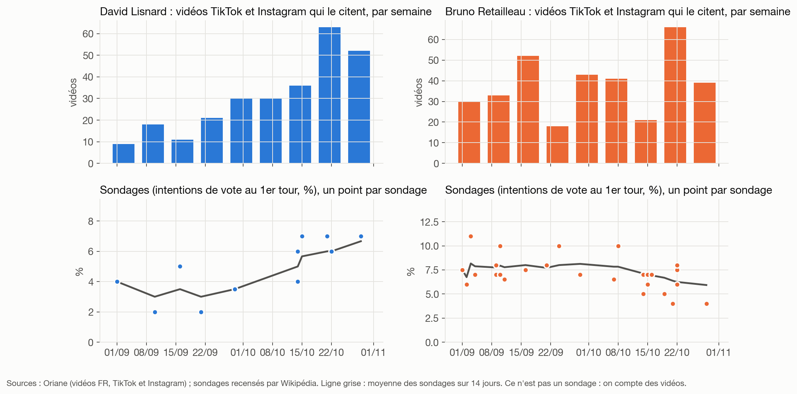
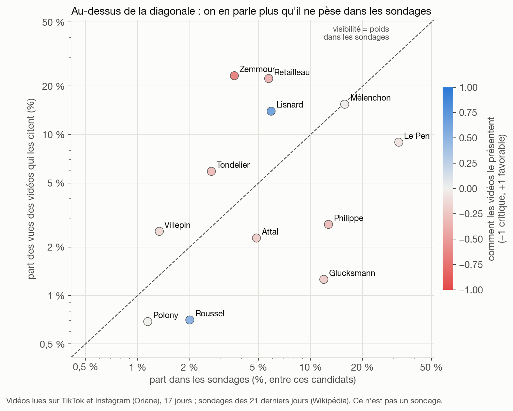

# Hack the Feed : le radar du matin

Projet de l'équipe TrendCatchers au hackathon Hack the Feed (Oriane × Lovable × Brut), le samedi 7 novembre 2026 à l'Albert School Paris, sur le sujet éditorial proposé par Brut.

Démo en ligne : [trendcatchers.vercel.app](https://trendcatchers.vercel.app)

> Un outil qui aide l'éditeur du matin de Brut à repérer les sujets de campagne qui montent sur TikTok et Instagram avant la presse, en lisant ce qui est dit et écrit dans les vidéos, pas les hashtags.

Ce dépôt contient le pipeline de données (Python) et le schéma de la base. L'interface de la démo lit cette base en lecture seule ; son code n'est pas ici.

## Le problème

Les outils de veille lisent les légendes et les hashtags. Beaucoup de créateurs n'y écrivent presque rien : le sujet est dit face caméra ou écrit à l'écran.

Sur les 9 992 vidéos lues le jour du hackathon, 3 278 (33 %) ne laissent pas deviner leur sujet par leur légende ni par leurs hashtags. Pour la manifestation contre la vie chère, c'est 41 % des 98 vidéos.

L'API d'Oriane fournit pour chaque vidéo sa transcription, le texte affiché à l'écran, sa légende et ses commentaires les plus populaires. On s'en sert pour lire la vidéo elle-même.

## Ce que voit la rédaction

- Le radar : les sujets classés, leur état (à traiter maintenant, course de vitesse, à surveiller, signal faible, stable, en baisse) et les signaux qui expliquent le classement.
- La fiche d'un sujet : pourquoi il monte, des citations exactes avec la seconde de la vidéo, les positions défendues, les médias qui l'ont déjà traité, un angle et un format pour Brut, et ce qu'il faut vérifier avant de tourner.
- La veille locale : les sujets nés dans une région avant d'être repris au national (le Sud-Ouest sert de démonstration) et les « comptes éclaireurs », de petits comptes qui publient tôt sur des sujets qui grossissent ensuite.
- La campagne 2027 : qui monte dans les vidéos, sur quel ton, et sa visibilité comparée à ses sondages.
- Le brief du matin : cinq sujets à lire en deux minutes, que l'éditeur valide ou écarte.

Les écrans, les tables et les colonnes sont décrits dans [docs/interface.md](docs/interface.md).

## Comment ça marche

Une commande (`python -m htf.cli run`) enchaîne sept étapes.

1. Collecter (`pipeline/htf/sources/`). Oriane est interrogée par thème et par jour : chaque requête renvoie un échantillon de vidéos et le nombre total de vidéos correspondantes, qui sert de poids. Deux filets sans mot-clé attrapent ce qu'aucun thème n'avait prévu : les vidéos françaises les plus commentées et partagées du jour, et celles qui font au moins trois fois l'audience de leur créateur. S'y ajoutent la presse (flux RSS et sitemaps d'archives), les chaînes YouTube et les comptes TikTok et Instagram des médias, le site de Brut, les tweets du Sud-Ouest (X, via Apify) et les sondages 2027 recensés par Wikipédia.
2. Lire (`annotate.py`). Claude Haiku résume chaque vidéo, article ou tweet en une phrase de sujet neutre, du style d'un titre de dépêche. Pour les vidéos, il donne aussi le ton, ce que la vidéo affirme, les personnalités citées, l'endroit où le sujet est exprimé (paroles, texte à l'écran, légende), une citation recopiée mot pour mot et la réaction dominante des commentaires.
3. Regrouper (`embed.py`, `analyze.py`). Les phrases de sujet sont vectorisées en local avec `bge-m3` (Ollama), puis regroupées par classification hiérarchique (distance cosinus, seuil 0,50). Un groupe de vidéos devient un sujet.
4. Mesurer (`analyze.py`). Trois signaux par sujet, détaillés plus bas.
5. Croiser (`analyze.py`, `local.py`, `polls.py`). Les médias suivis ont-ils déjà traité le sujet (similarité d'au moins 0,75) ? Circulait-il sur X avant la première vidéo ? Est-il né dans une région ? Pour les personnalités de la campagne, on compare leur part des vues à leur part dans les sondages.
6. Rédiger (`showcase.py`). Claude Opus écrit une fiche pour les vingt premiers sujets, à partir des chiffres et des vidéos fournis. Le brief du matin est assemblé à partir de ces fiches, sans appel supplémentaire.
7. Exporter (`export.py`). Les résultats partent dans Supabase, que lit l'interface.

### Le classement

```
accélération   = (vidéos par jour sur les 3 derniers jours + 1) / (vidéos par jour sur les 14 jours d'avant + 1)
surperformance = médiane, sur les vidéos récentes, de vues / abonnés du créateur
score          = accélération × √(créateurs récents) × min(surperformance, 3)
```

Un sujet en hausse que les médias suivis n'ont pas traité est « à traiter maintenant ». S'il est déjà couvert, c'est une « course de vitesse ». Un sujet trop petit pour le radar (moins de 8 vidéos ou de 4 créateurs) mais neuf et porté par au moins trois créateurs est un « signal faible ».

L'interface affiche le rang et les signaux plutôt qu'une note sur 100, pour que l'éditeur voie pourquoi un sujet est là.

### Garde-fous

- Une citation est cherchée mot à mot dans la transcription ou le texte à l'écran. Si on ne la retrouve pas, elle est supprimée. Sinon elle est affichée avec la seconde du passage.
- Sur des vidéos sans commentaires, le modèle inventait une réaction du public dix fois sur douze. Le code force maintenant « sans commentaires » dans ce cas.
- Oriane indexe les vidéos avec quelques jours de retard. L'analyse s'arrête au dernier jour indexé à au moins 50 %, et les poids sont corrigés du taux d'indexation de chaque jour.
- Un « angle mort » n'est affirmé que si l'on connaît la couverture des médias sur toute la période.
- Chaque appel au modèle est mis en cache et son coût compté. Un plafond bloque l'exécution avant de le dépasser.

## Résultats du 7 novembre

| Mesure | Valeur |
|---|---|
| Vidéos TikTok et Instagram lues | 9 992 |
| Tweets du Sud-Ouest (X, via Apify) | 3 562 |
| Contenus de médias (presse, YouTube, comptes des médias) | environ 17 000 |
| Sondages 2027 relevés | 46 |
| Sujets classés | 91 |
| Comptes éclaireurs repérés | 198, dont 48 du Sud-Ouest et 27 sur X |
| Coût total des appels à Claude, préparation comprise | 6,76 $ |
| Coût de la collecte X sur Apify | 1,01 $ |

Deux exemples sortis de la veille locale. « Bordeaux : le PV de police du 17 octobre publié » est né dans le Sud-Ouest avant d'être repris au national. Et « Lecornu à Limoges après l'incendie de l'hôtel de ville » circulait sur X avant la première vidéo TikTok ou Instagram.

Côté campagne, les vidéos qui citent David Lisnard passent de 9 à 21 par semaine en septembre à 30 par semaine dès le 29 septembre. Ses sondages passent de 2-5 % à 6-7 % à partir du 14 octobre, soit environ deux semaines plus tard. Bruno Retailleau sert de témoin : ses vidéos n'ont pas de tendance et ses sondages baissent. Les volumes sont petits : on y voit un signal précoce plausible, à confirmer.





## Contrôle humain

Erwan, dans l'équipe, a annoté 30 vidéos TikTok à l'aveugle, sans voir les réponses du modèle. Le protocole et les deux grilles sont dans [docs/controle/](docs/controle/).

- Ton : même réponse dans 19 cas sur 30. Six des onze désaccords portent sur des tons voisins (critique contre informatif), et deux inversent le sens de la vidéo.
- Ironie : sur les 7 vidéos qu'il juge ironiques, le modèle en repère 5.
- « La légende suffit-elle à deviner le sujet ? » : accord dans 18 cas sur 30. Le modèle est plus strict que lui : dans trois cas la légende disait bien le sujet. Les 33 % annoncés plus haut sont donc plutôt un plafond.
- Personnalités : le modèle retrouve au moins une des personnalités qu'il cite dans 11 vidéos sur 18.

Ce contrôle a aussi fait trouver une erreur. La légende était placée après les paroles puis coupée, si bien que 2 957 vidéos sur 9 192 avaient été annotées sans elle, ce qui gonflait la part « hors légende ». Les vidéos ont été rechargées et relues le jour même. Le détail est dans [docs/journal.md](docs/journal.md).

## Limites

- On mesure des vidéos. Ce n'est pas un sondage, et Oriane ne donne pas l'âge des spectateurs.
- Oriane a environ quatre jours de retard et n'indexe pas les comptes de moins de 5 000 abonnés. Environ 45 % des vidéos n'ont ni paroles ni texte à l'écran.
- La comparaison avec la presse sur des histoires passées n'est pas concluante : nos archives de presse ne remontent qu'au 21 octobre. On ne dit donc nulle part que l'outil voit un sujet « N jours avant la presse ».
- Le rapprochement avec la presse et avec X se fait par similarité de texte, avec quelques faux rapprochements possibles.
- X ne couvre que le Sud-Ouest, depuis le 22 octobre.
- Les partis, les camps politiques et les types de comptes (créateur, média, élu) ont été classés à la main par l'équipe.
- Les seuils ont été réglés sur une seule journée de données réelles.

## Lancer le pipeline

Il faut Python (testé avec la version 3.13), [Ollama](https://ollama.com) avec le modèle `bge-m3` (`ollama pull bge-m3`), un projet Supabase, une clé Oriane et une clé Anthropic. Le jeton Apify ne sert qu'à la collecte X.

```bash
python -m venv .venv
.venv/bin/pip install -r pipeline/requirements.txt
cp .env.example .env    # puis remplir les clés
```

Dans l'éditeur SQL de Supabase, exécuter `supabase/schema.sql`, puis chaque fichier `supabase/migration_*.sql`.

```bash
cd pipeline
PY=../.venv/bin/python

$PY -m pytest tests -q                               # 11 tests, sans réseau ni dépense
$PY -m htf.cli check                                 # clés, modèles, Ollama, Supabase
$PY -m htf.cli oriane-plan --days 17 --per-day 30    # nombre d'appels Oriane avant de lancer
$PY -m htf.cli run --days 17 --per-day 30 --top 20   # toute la chaîne
$PY -m htf.cli run --no-collect                      # rejouer l'analyse sans recollecter
$PY -m htf.cli cost                                  # dépense enregistrée
```

Sans clé Oriane, `$PY -m htf.cli fake` génère de fausses vidéos avec les mêmes champs, ce qui permet de faire tourner le reste de la chaîne (`media`, `annotate-social`, `annotate-media`, `analyze`, `showcase`, `export`). La liste complète des commandes : `$PY -m htf.cli --help`.

## Organisation du dépôt

```
pipeline/htf/
  cli.py          toutes les commandes
  config.py       modèles, prix, budget, seuils
  sources/        Oriane, presse et YouTube, archives, X via Apify, fausses vidéos de test
  annotate.py     lecture des vidéos, articles et tweets par le modèle
  embed.py        embeddings bge-m3 en local
  analyze.py      regroupement, score, état, couverture, citations
  local.py        veille locale et comptes éclaireurs
  politics.py     partis et camps des personnalités
  polls.py        sondages 2027 et surexposition
  showcase.py     fiches sujets et brief du matin
  snowball.py     relance ciblée des sujets imprévus
  backtest.py     comparaison avec la presse sur des histoires passées
  controle.py     tirage et comparaison du contrôle humain
  export.py       écriture dans Supabase
  pipeline.py     la chaîne complète (check, run)
pipeline/tests/   tests hors réseau
supabase/         schéma et migrations
scripts/          collecte de presse et relevé des sondages, à lancer par cron
docs/             brief, journal de bord, spécification de l'interface, contrôle humain, graphiques
```

## Documentation

- [docs/brief-brut.md](docs/brief-brut.md) : ce que Brut a demandé et comment l'outil y répond.
- [docs/journal.md](docs/journal.md) : le journal de bord, avec les mesures et les erreurs corrigées en route.
- [docs/interface.md](docs/interface.md) : les écrans et les tables lues par l'interface.
- [docs/controle/](docs/controle/) : le protocole du contrôle humain et les grilles.

## Équipe

TrendCatchers : Oscar, Alexandre et Erwan, étudiants à l'Albert School.
